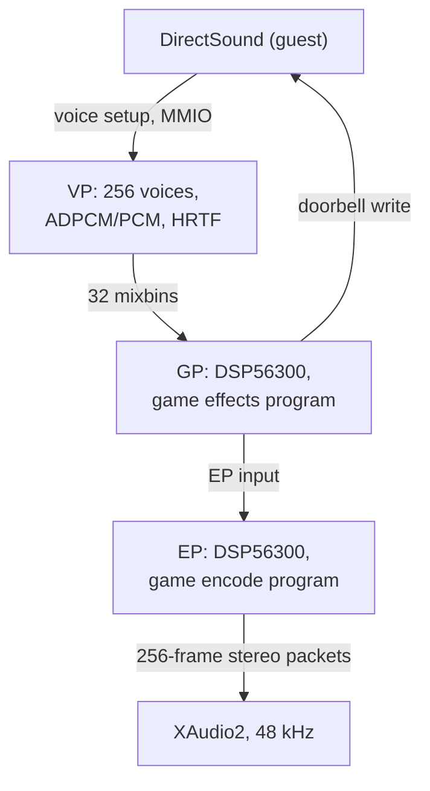

# xboxrecomp

Runtime for statically recompiled Xbox games. This fork targets accurate
hardware emulation and is developed for StarCraft: Ghost in
[xbox-on-deb](../xbox-on-deb).

## Build

The runtime libraries build standalone or as a subdirectory of a game project.
xbox-on-deb cross-compiles Ghost for Windows x64 and links them.

```sh
cmake -S . -B build
cmake --build build
```

The native Linux build needs SDL2, libepoxy, OpenSSL and ffmpeg, installed by
`bash tools/linux/install_deps.sh`. Windows builds use D3D11, XAudio2 and
XInput.

## Subsystems

### Kernel and memory

The runtime provides the kernel functions the game imports. This includes the
64 MB memory map and its mirrors, file and directory I/O, threads and sync
objects, the HAL, and crypto.

The game reads the current IRQL from the byte at `fs:[0x24]`. The runtime
stores IRQL there.

The Xbox has one CPU, so only one thread at a time can run at DISPATCH_LEVEL.
The runtime reproduces this with a recursive lock (`RECOMP_DISPATCH_LOCK`).

A dedicated thread acknowledges NV2A interrupts (`RECOMP_NV2A_IRQ_ACK`). The
D3D DPC then leaves DISPATCH promptly, and DirectSound keeps running.

### NV2A graphics

The game drives the NV2A GPU by writing pushbuffers. The runtime executes
them, including register writes made through MMIO.

PGRAPH methods are translated to D3D11. This covers fixed-function state,
register combiners, swizzled and linear textures, and vertex and index
buffers.

Each flip is read back and shown in the window.

### MCPX APU and audio

The Voice Processor (VP) plays up to 256 voices. It decodes ADPCM and PCM and
applies pitch, envelopes, filters and HRTF. Its output goes to 32 mixbins.

The game uploads DSP56300 programs to the Global Processor (GP) and the Encode
Processor (EP). The runtime runs them. The GP applies effects and writes
DirectSound's command doorbell. The EP produces the final stereo output.

Output plays through XAudio2 at 48 kHz. `RECOMP_APU_DSP=0` passes the mixbins
straight to the output, for comparison.



### USB and input

The runtime emulates the MCPX OHCI USB controllers. The game's own XAPI driver
finds the gamepad through them.

Keyboard and mouse can be mapped onto the pad. Every input edge can be
recorded to a file and replayed.

### Video and presentation

The game window presents through GDI by default. `RECOMP_PRESENT=d3d11` uses a
D3D11 swap chain, which ReShade can hook.

## Differences from upstream

| Area | Upstream | This fork | Reason |
| --- | --- | --- | --- |
| GP/EP DSP | mixbin passthrough | DSP56300 engine runs the game's downloaded programs | The game's effects and final mix are DSP programs; running them produces the console's output |
| DSP doorbell | synthesised acknowledgement | written by the running GP program | DirectSound waits on the completion the GP program writes |
| HRTF | off | on, matching xemu | The VP applies per-voice 3D filtering on hardware |
| Resampling | SRC stubs | vendored libsamplerate | Pitch-shifted voices resample through the same sinc converter as xemu |
| Release asserts | removed by `-DNDEBUG` | logged as `[APU-ASSERT]` lines | Hardware-state violations stay visible in release builds |
| DISPATCH exclusion | IRQL tracking only | recursive DISPATCH lock, NV2A IRQ-status ack thread | The console has one CPU; DISPATCH code never interleaves on it |

## Runtime switches

| Variable | Default | Effect |
| --- | --- | --- |
| `RECOMP_APU_DSP` | on | run the DSP56300 GP/EP engine; `0` selects the mixbin passthrough |
| `RECOMP_APU_DSP_ACK` | off | mailbox acknowledgement addresses for the passthrough path |
| `RECOMP_APU_HRTF`, `RECOMP_APU_HRTF_HEADROOM` | xemu | per-voice 3D filter A/B |
| `RECOMP_APU_DIAG`, `RECOMP_APU_VOICE_LEVELS` | off | `[APU-MIXSTAT]`, `[APU-VOICE-LVL]`, `[APU-MIXBIN]` diagnostics |
| `RECOMP_APU_DECLICK` | on | ramp abrupt mix steps; `0` A/Bs it |
| `RECOMP_APU_WAV` | off | capture output PCM to a wav |
| `RECOMP_DISPATCH_LOCK` | on | single-CPU DISPATCH_LEVEL exclusion; `0` disables |
| `RECOMP_NV2A_IRQ_ACK` | on | NV2A interrupt-status ack thread; `0` disables |

## Navigation map

| Path | Contents |
| --- | --- |
| `src/kernel/` | Kernel replacement, memory map, IRQL, pushbuffer executor |
| `src/d3d/` | D3D8 compatibility layer over D3D11 and OpenGL |
| `src/apu/`, `src/apu/dsp/` | MCPX APU, Voice Processor, DSP56300 GP/EP engine |
| `src/nv2a/` | NV2A register definitions and QEMU shims |
| `src/usb/`, `src/input/` | MCPX OHCI controllers and gamepad input |
| `src/video/` | Framebuffer present, input record and replay |
| `tools/`, `templates/` | Recompilation pipeline and project template |

Contribution rules and hooks live in [xbox-on-deb](../xbox-on-deb).

## Credits and licensing

- Upstream: [sp00nznet/xboxrecomp](https://github.com/sp00nznet/xboxrecomp),
  whose runtime, pipeline and documentation this fork builds on. Contributors
  are listed in [`CONTRIBUTORS.md`](CONTRIBUTORS.md).
- Ondrej Vanka (aknavj) seeded this fork with the NV2A to D3D11 bring-up, the
  DMA checks and the window handling.
- The MCPX APU (including `dsp/`) and the NV2A register definitions come from
  [xemu](https://github.com/xemu-project/xemu) under LGPL-2.1-or-later: espes,
  Jannik Vogel and Matt Borgerson. See [`NOTICE`](NOTICE),
  [`LICENSE`](LICENSE) and [`LICENSES/`](LICENSES).
- *Burnout 3: Takedown* was upstream's reference title and remains the toolkit's
  general test case.
