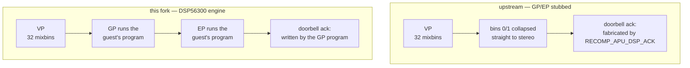
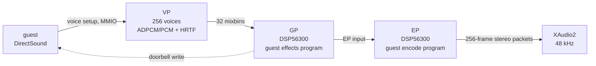

# xboxrecomp

A fork of [sp00nznet/xboxrecomp](https://github.com/sp00nznet/xboxrecomp) that
pushes the static-recompilation runtime toward **hardware accuracy**. The guest
XBE is lifted to C and runs natively; the hardware it talks to — the MCPX APU,
the NV2A GPU, OHCI USB, the kernel's IRQL model — is emulated the way the
console behaved, not approximated with a shortcut that merely runs the title.

The reference title is **StarCraft: Ghost** (the leaked May 2004 Xbox build),
driven from [xbox-on-deb](../xbox-on-deb).

This fork is not developed for upstream contribution. Upstream releases are
still merged for their hardware providers, but our behaviour lives as commits
here, on `main`.

## What accuracy means here

- **Run the program the guest downloaded.** When the title hands the audio DSP a
  program, the runtime executes it. It never fabricates a result the title reads
  back.
- **xemu is the reference.** Behaviour is checked against xemu's source line for
  line, and its defaults are adopted rather than invented.
- **Cxbx-Reloaded is the parity oracle.** An independently-derived emulator runs
  the same binary, so a recompiled defect can be told apart from a title defect.
- **A fault is information.** Stripping the invariant checks that would surface a
  hardware-protocol violation is a regression, not a release optimisation.
- **Model the console, not the desktop.** One CPU, IRQL as mutual exclusion,
  DISPATCH_LEVEL exclusion, x87 precision control.
- **Measure, then claim.** Every behavioural change carries an A/B switch and is
  verified against a run before it lands.
- **No silent shortcuts.** A skipped method, dropped packet or stale read is
  counted and named, never swallowed.

## Where this fork diverges from upstream

| Subsystem | Upstream | This fork | Why |
|---|---|---|---|
| GP/EP audio DSP | Stubs — effects bypass, mixbin 0/1 passthrough | xemu's DSP56300 interpreter; GP every frame, EP every eighth (`c9d9ced`, `e2a35e2`) | the stub produced garbled output; the guest's downloaded GP/EP programs are what generate the title's mix |
| DSP command doorbell | A synthesised acknowledgement (`RECOMP_APU_DSP_ACK=auto`) | the running GP program produces the write | the fake ack skips the effects image and cannot compute anything read back |
| Missing effects | Folds 32 mixbins to stereo, even left / odd right (`RECOMP_APU_MIXDOWN_ALL`) | the 32 bins are summed by the running GP/EP | the fold is a guess that changes output for every title |
| HRTF | `audio.hrtf = false` | xemu's default, on (`0db1b45`) | off sums a mono 3D voice into all four XTLK bins; positional effects play ~10 dB hot |
| Resampling | SRC stubs | vendored libsamplerate, xemu's `src_callback_read` pull (`ebbf415`) | the stubs discarded the source rate |
| xemu invariants | `-DNDEBUG` strips them in Release | `assert()` shadowed as a throttled, non-fatal `[APU-ASSERT]` logger (`119720c`) | a protocol violation was silently reading out of bounds |
| Kernel IRQL | thread-local level kept in step with a mirror | the guest TIB byte, `fs:[0x24]`, is the single source of truth (`64d34b7`) | the two values drifted whenever a guest callback ran on a host thread |
| IRQL exclusion | — | a recursive DISPATCH lock plus a ~1 ms NV2A IRQ-status ack thread (`1f0a84b`) | DirectSound's DPC and a title thread interleaved one voice's segment list and the stream looped |
| x87 | precision control not applied to results | arithmetic rounded through `RECOMP_FP_PC` (`a4059e2`) | a PC=24 guest must see float-precision intermediates |
| Change delivery | pull requests to `sp00nznet/xboxrecomp` | commits on this fork only (`e223a5b`) | the runtime is ours to evolve |

## The APU / DSP path

The MCPX APU is the clearest case of the fork's philosophy, and the subsystem
that took the most work. Upstream leaves the GP and EP DSPs as stubs: the Voice
Processor's 32 mixbins are mixed straight down to stereo, and DirectSound's
command doorbell is answered by a hard-coded acknowledgement. The guest never
runs the code it downloaded, and the effects it asked for are never computed.



Signal path when the engine runs, as on hardware:



This fork runs it. `c9d9ced` ports xemu's DSP56300 interpreter into the runtime
(`src/apu/dsp/`), `e2a35e2` turns it on by default, and the guest's own GP/EP
programs produce both the mix and the mailbox acknowledgement. On top of that:

- the VP/GP/EP pipeline, rollout and HRTF gate were checked against xemu's
  `vp.c` and `gp_ep.c` (`0db1b45`);
- the real libsamplerate replaced the SRC stubs (`ebbf415`);
- the frame clock, the streaming (SSL) underrun handling and the XAudio2
  submit/backpressure path were each fixed, and the earlier heuristics that
  patched symptoms were reverted rather than kept (`119720c`, `ebbf415`,
  `9881cfc` → `c3af9dc`, `9a9f8ee` → `91113df`, `201670a`);
- the xemu invariants came back as non-fatal loggers (`119720c`).

The register model, the DMA/contiguous-bank integration and the diagnostics are
documented in [`src/apu/README.md`](src/apu/README.md).

## Status

StarCraft: Ghost boots, reaches the menus, and plays missions with audio,
controller, and keyboard-and-mouse input — cross-built for Windows x64 by
xbox-on-deb and run under GE-Proton.

Known gaps: the native-Linux host (SDL2 + OpenGL) is far less exercised than the
Windows cross-build; audio balance and 3D spatialisation are operator-verified
against xemu rather than covered by an automated test; and merged upstream
releases bring providers we adopt without auditing every line.

## Build

The game is cross-compiled for Windows x64 by
[xbox-on-deb](../xbox-on-deb) (zig + MinGW; `recomp/game/build.sh`, run under
GE-Proton). This repository produces the runtime libraries only — it has no
`main()`.

A native Linux build of the libraries (SDL2, libepoxy, OpenSSL, ffmpeg) is
also available:

```sh
cmake -S . -B build
cmake --build build
```

Its dependencies: `bash tools/linux/install_deps.sh`.

## Runtime switches

| Variable | Default | Effect |
|---|---|---|
| `RECOMP_APU_DSP` | on | run the DSP56300 GP/EP engine; `0` selects the upstream passthrough stub |
| `RECOMP_APU_DSP_ACK` | off | diagnostic mailbox ack addresses; only meaningful with the stub |
| `RECOMP_APU_HRTF`, `RECOMP_APU_HRTF_HEADROOM` | xemu | per-voice 3D filter A/B |
| `RECOMP_APU_DIAG`, `RECOMP_APU_VOICE_LEVELS` | off | `[APU-MIXSTAT]`, `[APU-VOICE-LVL]`, `[APU-MIXBIN]` diagnostics |
| `RECOMP_APU_DECLICK` | on | ramp abrupt mix steps; `0` A/Bs it |
| `RECOMP_APU_WAV` | off | capture output PCM to a wav for offline analysis |
| `RECOMP_DISPATCH_LOCK` | on | single-CPU DISPATCH_LEVEL exclusion; `0` disables |
| `RECOMP_NV2A_IRQ_ACK` | on | ~1 ms NV2A interrupt-status ack thread; `0` disables |

## Credits and licensing

- Upstream: [sp00nznet/xboxrecomp](https://github.com/sp00nznet/xboxrecomp),
  whose runtime, pipeline and documentation this fork builds on. Contributors
  are listed in [`CONTRIBUTORS.md`](CONTRIBUTORS.md).
- Ondrej Vanka (aknavj) seeded this fork with the NV2A → D3D11 bring-up, the DMA
  checks and the window handling.
- The MCPX APU (including `dsp/`) and the NV2A register definitions are extracted
  from [xemu](https://github.com/xemu-project/xemu) under LGPL-2.1-or-later —
  espes, Jannik Vogel and Matt Borgerson. See [`NOTICE`](NOTICE),
  [`LICENSE`](LICENSE) and [`LICENSES/`](LICENSES).
- *Burnout 3: Takedown* was upstream's reference title and remains the toolkit's
  general test case.