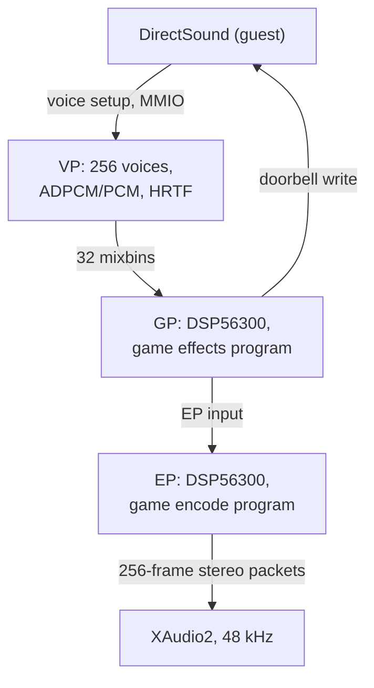

# xboxrecomp

**xboxrecomp** is a runtime for statically recompiled original Xbox games. The
game's x86 code is lifted to C and runs natively; the runtime emulates the
console hardware underneath it.

This fork aims for hardware emulation accuracy: the runtime behaves the way the
Xbox hardware does, so the game's own code paths run unchanged. It is developed
for StarCraft: Ghost in [xbox-on-deb](../xbox-on-deb).

## Build

The runtime libraries build standalone or as a subdirectory of a game project.
xbox-on-deb cross-compiles Ghost for Windows x64 and links them.

```sh
cmake -S . -B build
cmake --build build
```

The native Linux build needs SDL2, libepoxy, OpenSSL and ffmpeg, installed by
`bash tools/linux/install_deps.sh`. Windows builds use D3D11, XAudio2 and
XInput.

## Subsystems

### Kernel and memory

Answers the game's kernel imports: the 64 MB memory map with its mirrors, file
and directory I/O, threading, synchronisation, the HAL and crypto. IRQL is read
and written through the guest thread-information-block byte (`fs:[0x24]`),
which is the value the game itself reads. The runtime models the console's
uniprocessor DISPATCH_LEVEL exclusion: a recursive lock is held by whichever
thread is at or above DISPATCH, so a DPC and a game thread do not interleave
one voice's descriptor list. A dedicated thread acknowledges NV2A interrupt
status so a D3D DPC does not sit at DISPATCH and starve DirectSound.

### NV2A graphics

The NV2A register handlers, MMIO interception and pushbuffer executor run the
game's own command stream. PGRAPH methods are translated to D3D11: fixed
function state, register combiners, swizzled and linear texture decode, vertex
and index buffers. The present path reads back staged flips and publishes them
to the window.

### MCPX APU and audio

The Voice Processor runs 256 hardware voices with ADPCM and PCM decode, pitch,
envelopes, per-voice filters and HRTF. The GP and EP run the DSP56300 programs
the game downloads; those programs produce the mix and complete DirectSound's
command doorbell. Output is XAudio2 at 48 kHz. `RECOMP_APU_DSP=0` selects a
mixbin passthrough for comparison.



### USB and input

MCPX OHCI host controllers expose the gamepad to the game's own XAPI. The
runtime maps a keyboard and mouse onto the pad and records input edges for
replay.

### Video and presentation

The framebuffer window presents through GDI, or through a D3D11/DXGI swap chain
(`RECOMP_PRESENT=d3d11`) for a ReShade proxy. Window input is recorded and can
be replayed hands-free.

## Differences from upstream

Each change moves a component toward the hardware's behaviour, so the game's
code gets the results it was written against.

| Area | Upstream | This fork | Reason |
| --- | --- | --- | --- |
| GP/EP DSP | mixbin passthrough | DSP56300 engine runs the game's downloaded programs | The game's effects and final mix are DSP programs; running them produces the console's output |
| DSP doorbell | synthesised acknowledgement | written by the running GP program | DirectSound waits on the completion the GP program writes |
| HRTF | off | on, matching xemu | The VP applies per-voice 3D filtering on hardware |
| Resampling | SRC stubs | vendored libsamplerate | Pitch-shifted voices resample through the same sinc converter as xemu |
| Release asserts | removed by `-DNDEBUG` | logged as `[APU-ASSERT]` lines | Hardware-state violations stay visible in release builds |
| IRQL | thread-local value | guest TIB byte `fs:[0x24]` | The game reads IRQL from that byte |
| DISPATCH exclusion | shared IRQL value | recursive DISPATCH lock, NV2A IRQ-status ack thread | The console has one CPU; DISPATCH code never interleaves on it |
| x87 precision | results kept at double precision | rounded through `RECOMP_FP_PC` | When the game sets the x87 control word to single precision, results round to a 24-bit mantissa as on the CPU |

## Runtime switches

| Variable | Default | Effect |
| --- | --- | --- |
| `RECOMP_APU_DSP` | on | run the DSP56300 GP/EP engine; `0` selects the mixbin passthrough |
| `RECOMP_APU_DSP_ACK` | off | mailbox acknowledgement addresses for the passthrough path |
| `RECOMP_APU_HRTF`, `RECOMP_APU_HRTF_HEADROOM` | xemu | per-voice 3D filter A/B |
| `RECOMP_APU_DIAG`, `RECOMP_APU_VOICE_LEVELS` | off | `[APU-MIXSTAT]`, `[APU-VOICE-LVL]`, `[APU-MIXBIN]` diagnostics |
| `RECOMP_APU_DECLICK` | on | ramp abrupt mix steps; `0` A/Bs it |
| `RECOMP_APU_WAV` | off | capture output PCM to a wav |
| `RECOMP_DISPATCH_LOCK` | on | single-CPU DISPATCH_LEVEL exclusion; `0` disables |
| `RECOMP_NV2A_IRQ_ACK` | on | NV2A interrupt-status ack thread; `0` disables |

## Navigation map

| Path | Contents |
| --- | --- |
| `src/kernel/` | Kernel replacement, memory map, IRQL, pushbuffer executor |
| `src/d3d/` | D3D8 compatibility layer over D3D11 and OpenGL |
| `src/apu/`, `src/apu/dsp/` | MCPX APU, Voice Processor, DSP56300 GP/EP engine |
| `src/nv2a/` | NV2A register definitions and QEMU shims |
| `src/usb/`, `src/input/` | MCPX OHCI controllers and gamepad input |
| `src/video/` | Framebuffer present, input record and replay |
| `tools/`, `templates/` | Recompilation pipeline and project template |

Contribution rules and hooks live in [xbox-on-deb](../xbox-on-deb).

## Credits and licensing

- Upstream: [sp00nznet/xboxrecomp](https://github.com/sp00nznet/xboxrecomp),
  whose runtime, pipeline and documentation this fork builds on. Contributors
  are listed in [`CONTRIBUTORS.md`](CONTRIBUTORS.md).
- Ondrej Vanka (aknavj) seeded this fork with the NV2A to D3D11 bring-up, the
  DMA checks and the window handling.
- The MCPX APU (including `dsp/`) and the NV2A register definitions come from
  [xemu](https://github.com/xemu-project/xemu) under LGPL-2.1-or-later: espes,
  Jannik Vogel and Matt Borgerson. See [`NOTICE`](NOTICE),
  [`LICENSE`](LICENSE) and [`LICENSES/`](LICENSES).
- *Burnout 3: Takedown* was upstream's reference title and remains the toolkit's
  general test case.
