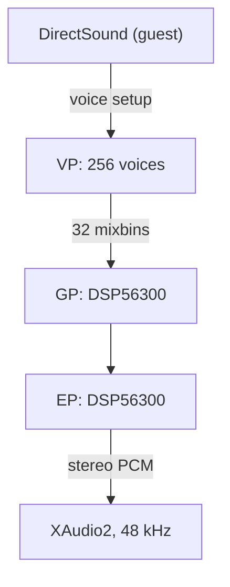

# Xbox static-recompilation runtime

**xboxrecomp** is the runtime that statically recompiled original Xbox games
link against, emulating the console hardware each game drives, including the
DSP56300 audio programs it downloads to the APU.

It runs StarCraft: Ghost for [xbox-on-deb](../xbox-on-deb).

## Build

```sh
cmake -S . -B build
cmake --build build
```

Linux dependencies: `bash tools/linux/install_deps.sh`.

## Audio

The Voice Processor decodes the game's 256 voices into mixbins. The GP and EP
run the DSP56300 programs the game downloads, which produce the final mix.



## Layout

| Path | Contents |
| --- | --- |
| `src/kernel/` | Kernel, memory map, pushbuffer executor |
| `src/apu/` | MCPX APU and DSP56300 engine |
| `src/d3d/`, `src/nv2a/` | NV2A graphics over D3D11 |
| `src/usb/`, `src/input/`, `src/video/` | Input, presentation, record and replay |
| `tools/` | Recompilation pipeline |

## Credits and licensing

Built on [sp00nznet/xboxrecomp](https://github.com/sp00nznet/xboxrecomp)
([`CONTRIBUTORS.md`](CONTRIBUTORS.md)), with the NV2A to D3D11 bring-up by
Ondrej Vanka (aknavj). The MCPX APU, DSP56300 and NV2A definitions come from
[xemu](https://github.com/xemu-project/xemu) under LGPL-2.1-or-later; see
[`NOTICE`](NOTICE) and [`LICENSE`](LICENSE).
